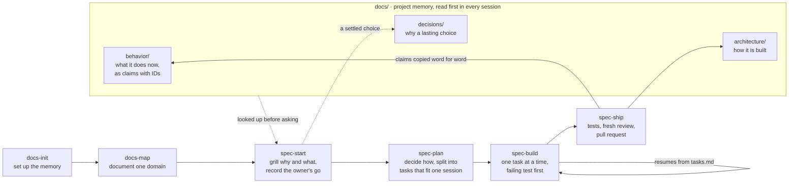

# scrubjay

**A spec workflow and project memory for coding agents, kept in your repo's `docs/`.**

Scrub-jays hide food and remember what they hid, where and when. This pack gives coding agents the same memory: what was decided, where it lives, and when it changed. It is eight markdown skills, no server, no runtime, no telemetry. Tested on Claude Code and Codex, installs on GitHub Copilot CLI, loads in any agent that supports [Agent Skills](https://agentskills.io).

> **Status: pre-release.** v0.1 is built and shipping on [its own spec](docs/specs/2026-10-12-v0-1/spec.md). Install steps, commands and the quickstart are in the [pack README](plugin/README.md).

## The problem

Every new agent session starts from zero, so you explain the project again. And an agent handed a one-line request builds something, just not always the thing you meant.

Two bets, tested on real work:

1. **Memory.** Agents keep project knowledge across sessions when it lives in `docs/`, in the repo, next to the code.
2. **Intent.** Agents build the right thing when the intent is grilled into testable claims before any code, and the owner says go.

## How it works



Six commands you run, two practices the agent loads on its own: `grilling`, the question rounds, and `docs-conventions`, the file charter and templates.

| Command | Use it to |
| --- | --- |
| `docs-init` | add project memory to a repo: `docs/index.md`, the stack, the block in `AGENTS.md` |
| `docs-map` | document one domain of an existing app from its code, the first time work touches it |
| `spec-start` | start a spec from a sentence, a ticket or commits; grill it into claims; record the go |
| `spec-plan` | decide how and break the work into tasks that fit one session each |
| `spec-build` | build task by task, test first; a new session resumes from `tasks.md` |
| `spec-ship` | run the tests, get a fresh review, update `docs/`, prepare the pull request |

## What it writes into your repo

```
AGENTS.md                              one managed block between markers; the rest stays yours
docs/
  index.md                             what the product is, its domains and their owners
  behavior/<domain>/<capability>.md    what the product does now, as claims with IDs
  architecture/<area>.md               how it is built, one area per file
  decisions/<date>-<slug>.md           why a lasting choice was made
  specs/<date>-<slug>/                 one folder per change: spec.md, plan.md, tasks.md
```

A claim is one testable sentence with an ID and an example. Tests carry the claim's reference in their name, and at ship the claims are copied into `behavior/` word for word, so the docs say exactly what the tests prove.

## Install

Claude Code:

```
/plugin marketplace add yousefallaban/scrubjay
/plugin install scrubjay@yousefallaban
```

Codex:

```
codex plugin marketplace add yousefallaban/scrubjay
codex plugin add scrubjay@yousefallaban
```

GitHub Copilot CLI:

```
copilot plugin marketplace add yousefallaban/scrubjay
copilot plugin install scrubjay@yousefallaban
```

Any other agent with Agent Skills: copy the eight folders under [`plugin/skills/`](plugin/skills) into its skills directory. Per-repo installs, private copies and how updates reach you are in the [pack README](plugin/README.md#install).

## Quickstart, about five minutes

1. `docs-init`, answer four questions: the product, the first domain and its owner, your issue tracker, the test command.
2. Open a new session and ask "where does project memory live?". It answers from `docs/`. That is bet one.
3. `spec-start` with one sentence about what you want. A feature gets grilled in rounds, each question with a recommended answer. Say go.
4. `spec-plan`, OK the plan, then `spec-build`, one task per session if you like. A fresh session told "continue" picks up at the next task.
5. `spec-ship`. Tests, a fresh review, the docs updated, a pull request title and description ready to paste.

## What makes it different

- **The owner's go is on record.** A feature is not planned, and behavior is not shipped, without an `approved` line that says who and where. Enthusiasm is never read as a go.
- **Claims, not prose.** Why and what settle into claims with IDs. The plan names the claims each task proves, the tests carry them, and `behavior/` holds them after ship.
- **Resume is real.** A new session, person or agent reads `tasks.md` and names the next task unprompted. Checked by hand on both tested agents.
- **A fresh reviewer.** Shipping asks a context that did not write the code to compare the diff with the spec, and puts the findings in the pull request.
- **Changing your mind is handled.** Mid-build, the right file is updated, every task rechecked, the go renewed if the what changed. Scope growth becomes a follow-up spec.
- **Nothing to run.** Markdown skills and templates. It stacks with the skills you already use for code quality, testing or a language; it only holds the workflow around them.

Every skill is written test-first against a small example webshop, with eval cases that run with and without the pack, and the pack is built with its own flow.

## Works with

| Agent | Status |
| --- | --- |
| Claude Code | tested, release check passes every case |
| Codex | tested, every command run by hand |
| GitHub Copilot CLI | installs from the repo unchanged, not a test target |
| VS Code Copilot, Cursor, Gemini CLI, Kiro and others with Agent Skills | copy `plugin/skills/` |

## Developing the pack

| Path | What it is |
| --- | --- |
| [`AGENTS.md`](AGENTS.md) | instructions for any agent building the pack |
| [`docs/specs/`](docs/specs) | the spec this pack is built from, in its own format, with the decisions behind it |
| [`plugin/`](plugin) | what users install: skills, templates, manifests, eval cases |
| [`checks/`](checks) | the static checks CI runs, and the by-hand protocols with their transcripts |
| [`ROADMAP.md`](ROADMAP.md) | what comes after v0.1, and the signals that would add it |

Run `sh checks/run.sh` before a pull request; CI runs the same. Eval cases run with `claude plugin eval plugin --scaffold --allow-tools Write Edit --trust-plugin`, see [`plugin/evals/README.md`](plugin/evals/README.md).

## Credits and license

The mechanics learned from other packs are in [CREDITS.md](plugin/CREDITS.md). [MIT](LICENSE), by Yousef Allaban.
