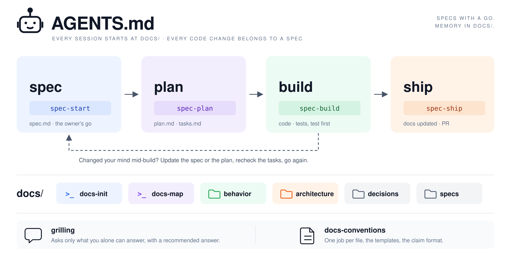

# scrubjay

**A spec workflow and project memory for coding agents, kept in your repo's `docs/`.**

Scrub-jays hide food and remember what they hid, where and when. This pack gives coding agents the same memory: what was decided, where it lives, and when it changed. It is eight markdown skills, no server, no runtime, no telemetry. Tested on Claude Code and Codex, installs on GitHub Copilot CLI, loads in any agent that supports [Agent Skills](https://agentskills.io).

## The problem

Every new agent session starts from zero, so you explain the project again. And an agent handed a one-line request builds something, just not always the thing you meant.

Two bets, tested on real work:

1. **Memory.** Agents keep project knowledge across sessions when it lives in `docs/`, in the repo, next to the code.
2. **Intent.** Agents build the right thing when the intent is grilled into testable claims before any code, and the owner says go.

## How it works



Six commands you run, two practices the agent loads on its own: `grilling`, the question rounds, and `docs-conventions`, the file charter and templates.

| Command | Use it to |
| --- | --- |
| `docs-init` | add project memory to a repo: `docs/index.md`, the stack, the block in `AGENTS.md` |
| `docs-map` | document one domain of an existing app from its code, the first time work touches it |
| `spec-start` | start a spec from a sentence, a ticket or commits; grill it into claims; record the go |
| `spec-plan` | decide how and break the work into tasks that fit one session each |
| `spec-build` | build task by task, test first; a new session resumes from `tasks.md` |
| `spec-ship` | run the tests, get a fresh review, update `docs/`, prepare the pull request |

## What it writes into your repo

```
AGENTS.md                              one managed block between markers; the rest stays yours
docs/
  index.md                             what the product is, its domains and their owners
  behavior/<domain>/<capability>.md    what the product does now, as claims with IDs
  architecture/<area>.md               how it is built, one area per file
  decisions/<date>-<slug>.md           why a lasting choice was made
  specs/<date>-<slug>/                 one folder per change: spec.md, plan.md, tasks.md
```

A claim is one testable sentence with an ID and an example. A claim's test carries the claim's reference in its name, and at ship the claims are copied into `behavior/` word for word, so the docs say exactly what the tests prove.

## Install

Any agent, one command, through the open [skills CLI](https://skills.sh):

```
npx skills add yousefallaban/scrubjay
```

Or as a plugin, which keeps the skills namespaced and versioned. Claude Code:

```
/plugin marketplace add yousefallaban/scrubjay
/plugin install scrubjay@yousefallaban
```

Codex:

```
codex plugin marketplace add yousefallaban/scrubjay
codex plugin add scrubjay@yousefallaban
```

GitHub Copilot CLI:

```
copilot plugin marketplace add yousefallaban/scrubjay
copilot plugin install scrubjay@yousefallaban
```

Any other agent with Agent Skills: the one command above, or copy the eight folders under [`plugin/skills/`](plugin/skills) into its skills directory. Per-repo installs, private copies and how updates reach you are in the [pack README](plugin/README.md#install).

## Quickstart

After installing the pack, open your project in your coding agent. The steps below use short skill names. For plugin installs, use `/scrubjay:docs-init` in Claude Code or `$scrubjay:docs-init` in Codex, and the same prefix for the other commands.

1. **Set up project memory.** Run `docs-init`. Describe the product, name the first domain and its owner, add your issue tracker if you have one, and confirm the test command.

2. **Check that memory carries over.** Open a new session and ask, "Where does project memory live?" The agent should point you to `docs/`.

3. **Describe a small change.** Run `spec-start` with a request such as "Customers can save products to a wishlist." Answer the questions, review the resulting spec, and say go when the scope is right.

4. **Approve the plan.** Run `spec-plan`. Review the approach and task list, then give your OK before building starts.

5. **Build and resume.** Run `spec-build` to work through the tasks. To pick up later, open a new session and say "continue"; the agent resumes from `tasks.md`.

6. **Prepare the pull request.** Run `spec-ship`. It runs the tests, gets a fresh review, updates the project docs, and prepares the PR. You decide when to merge.

## What makes it different

- **Approval stays with the spec.** The owner's go records who approved the change and where. Features wait for that approval before planning; behavior changes need it before shipping.

- **Requirements connect to tests.** Each requirement is a testable claim with an ID and an example. Tasks and tests refer to those claims, which become the project's behavior docs after shipping.

- **Progress survives a new session.** `tasks.md` records what is done and what comes next. A new person or agent can pick up from that file without reconstructing the conversation.

- **Review checks the agreed scope.** A reviewer who did not write the change compares the diff with the spec. Their findings go into the pull request.

- **Plans can change mid-build.** The workflow updates the relevant document and rechecks the tasks; a small polish reopens one task instead. Changed requirements need renewed approval; extra scope gets a separate spec, and anything deferred is settled when the spec ships.

- **Use it with your existing skills.** The pack is markdown skills and templates, with no service to run. Keep your language, testing and code-quality skills alongside it.

Every skill is written test-first against a small example webshop, with eval cases that run with and without the pack, and the pack is built with its own flow.

## Works with

| Agent | Status |
| --- | --- |
| Claude Code | tested, release check passes every case |
| Codex | tested, every command run by hand |
| GitHub Copilot CLI | installs from the repo unchanged, not a test target |
| VS Code Copilot, Cursor, Gemini CLI, Kiro and others with Agent Skills | copy `plugin/skills/` |

## Developing the pack

| Path | What it is |
| --- | --- |
| [`AGENTS.md`](AGENTS.md) | instructions for any agent building the pack |
| [`docs/specs/`](docs/specs) | the spec this pack is built from, in its own format, with the decisions behind it |
| [`plugin/`](plugin) | what users install: skills, templates, manifests, eval cases |
| [`checks/`](checks) | the static checks CI runs, and the by-hand protocols with their transcripts |

Run `sh checks/run.sh` before a pull request; CI runs the same. Eval cases run with `claude plugin eval plugin --scaffold --allow-tools Write Edit --trust-plugin`, see [`plugin/evals/README.md`](plugin/evals/README.md).

## Credits and license

The mechanics learned from other packs are in [CREDITS.md](plugin/CREDITS.md). [MIT](LICENSE), by Yousef Allaban.
